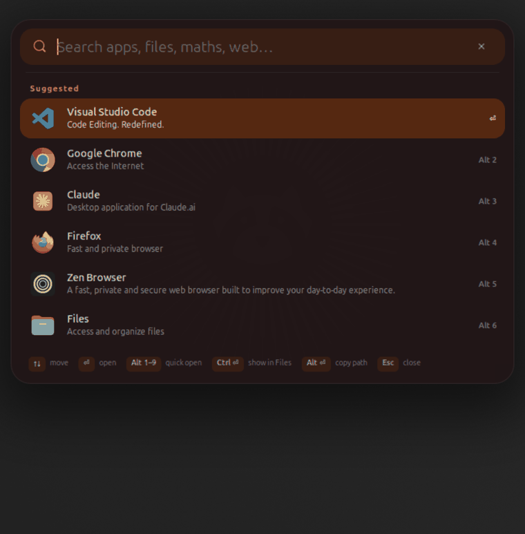
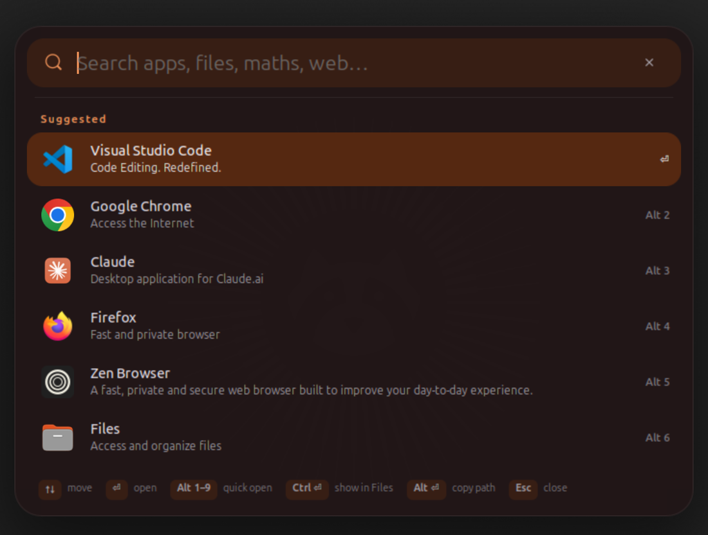
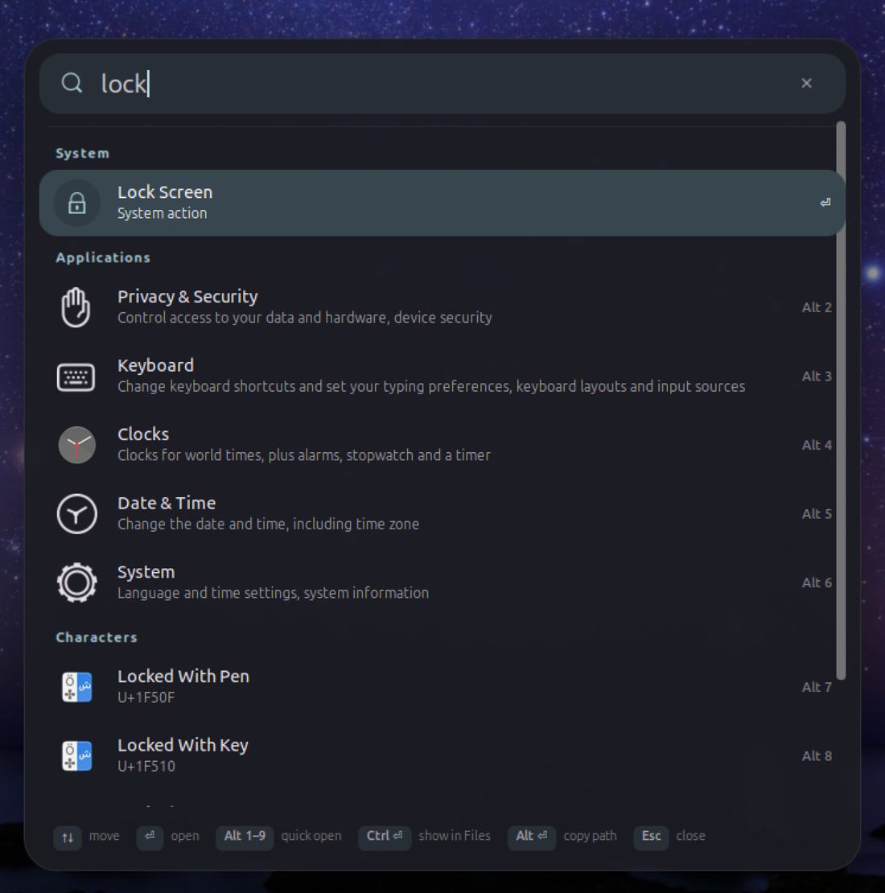
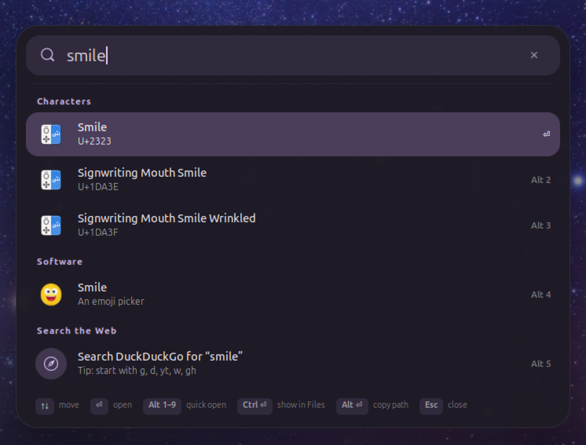
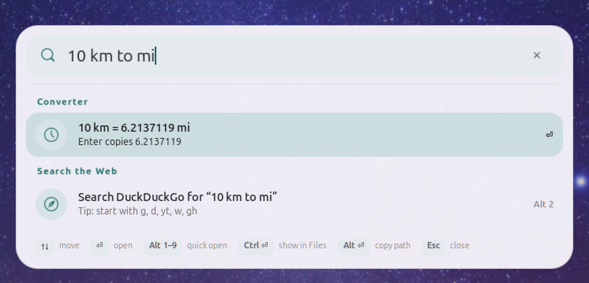
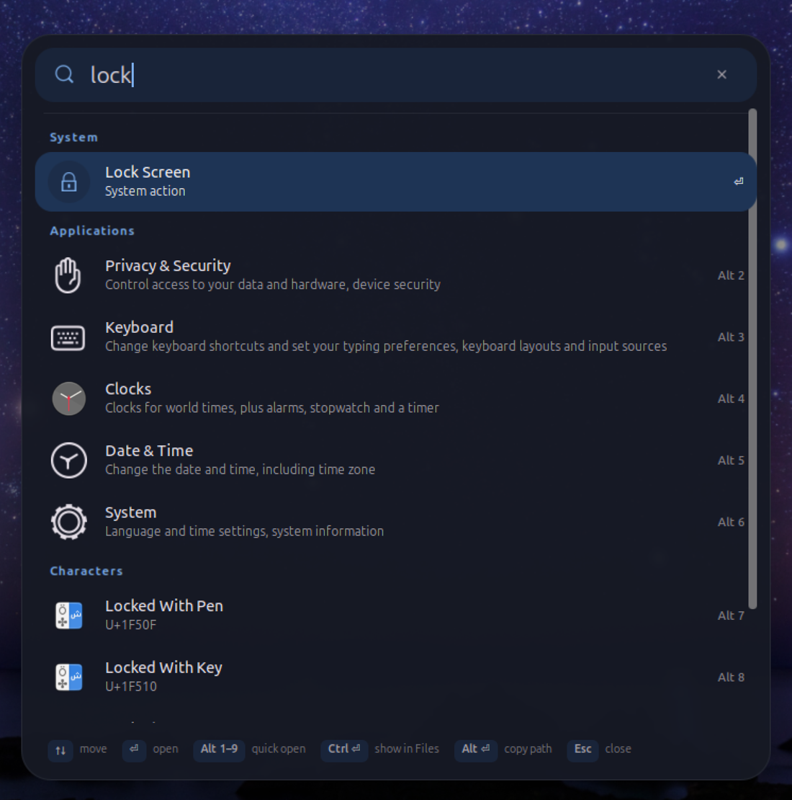
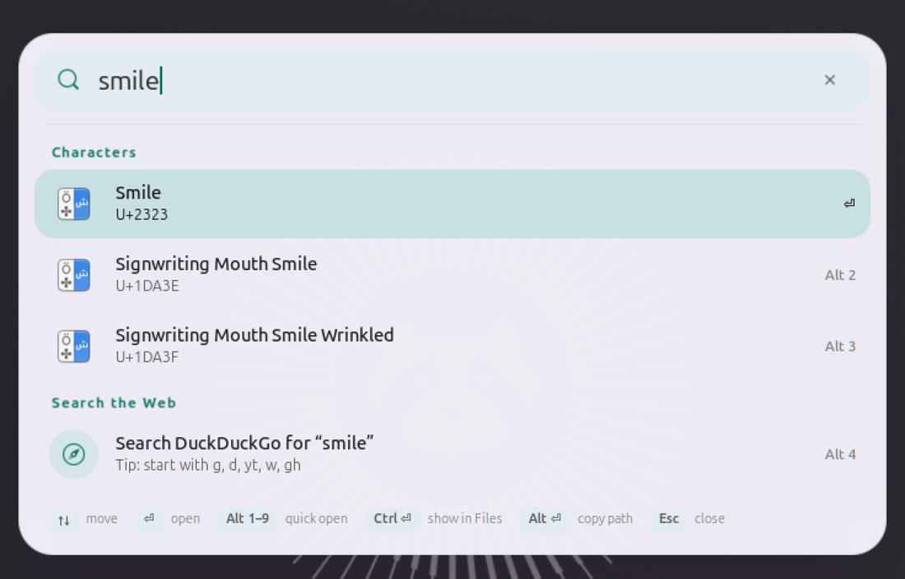
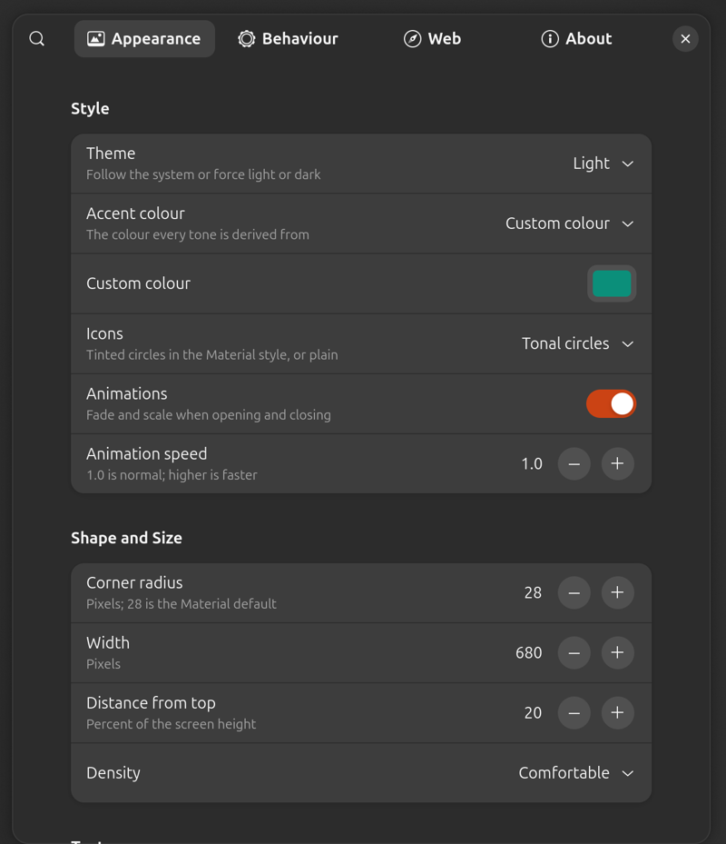

<p align="center"></p>

<h1 align="center">Eureka</h1>

<p align="center">
  <b>Spotlight-style search for GNOME 50.</b><br>
  Press <kbd>Super</kbd> + <kbd>Space</kbd>, type, press <kbd>Enter</kbd>. Press it again to close.
</p>

<p align="center">
  <a href="https://extensions.gnome.org/extension/11499/eureka/"></a>
</p>

<p align="center">
  
  
  
  
  <a href="https://buymeacoffee.com/shahriyarfarhan"></a>
</p>

<p align="center">
  
</p>

*Eureka!* is Greek for "I found it!", what Archimedes shouted in his bath. That is the moment this extension is for:
one box for your apps, windows, files, folders, emoji, settings, maths, conversions and the web, in your colours, at
the speed you type.

## Highlights

<table>
<tr>
<td width="50%" valign="top">

### ⚡ Instant
Apps, windows, maths and system actions appear on the first key press. Files and app searches follow 120 ms later,
and a search you have typed past is cancelled, so nothing old flickers in.

</td>
<td width="50%" valign="top">

### 🎨 Your colours, Material You style
Pick one accent (your system's, Nord, Catppuccin, anything) and Eureka derives every tone from it: panel, field,
selection, icon circles. Light, dark or follow the system, with real frosted blur.

</td>
</tr>
<tr>
<td valign="top">

### 🔎 One box, everything
Apps, open windows, files and folders, emoji, Settings pages, clocks, contacts, a calculator, unit and currency
converters, lock / suspend / restart and web search. It even suggests your most used apps before you type.

</td>
<td valign="top">

### ⌨️ Made for the keyboard
<kbd>Alt</kbd>+<kbd>1</kbd>…<kbd>9</kbd> opens any result directly, <kbd>Ctrl</kbd>+<kbd>Enter</kbd> shows a file in
Files, <kbd>Alt</kbd>+<kbd>Enter</kbd> copies its path. Web prefixes like `yt lofi` or `gh eureka` jump straight to
the site.

</td>
</tr>
<tr>
<td valign="top">

### 🛠️ Shortcut clash fixer
Choose a preset or record any combination, plus a second one. If GNOME or one of your own custom shortcuts already
uses it, Eureka says which action and frees it with one click. The same shortcut opens and closes.

</td>
<td valign="top">

### 🧮 Maths and units, offline
`sqrt(2)*pi`, `2^10`, `sin(0.5)`, `ln(10)` without `eval`. 8 unit types (length, mass, volume, area, speed, time,
data, temperature) with no internet at all. An opt-in currency converter with the European Central Bank's rates.

</td>
</tr>
<tr>
<td valign="top">

### 🔒 Secure by design
No tracking, nothing logged, no shell commands, and it never runs a program it finds. No network unless you turn on
currencies, and even then your searches stay on your computer. [Details below](#privacy-and-security).

</td>
<td valign="top">

### 🧩 Feels like GNOME
Uses GNOME's own search providers, file index, blur and *Reduce animation* setting. Opens on the screen under your
pointer. Draws its own window and never touches the overview, so it cannot break GNOME's search.

</td>
</tr>
</table>

## Your colours

Every colour comes from one accent: your system's, or any colour you pick.

<p align="center">
  
  
</p>
<p align="center">
  
  
</p>
<p align="center"><sub>Blue · Nord <code>#88c0d0</code> · Catppuccin <code>#cba6f7</code> · light with teal <code>#1a7f72</code></sub></p>

## Install

**Easiest: Extension Manager or extensions.gnome.org.** Open the *Extension Manager* app, search for **Eureka**,
click **Install**. Or open [Eureka on extensions.gnome.org](https://extensions.gnome.org/extension/11499/eureka/).

**From GitHub:** download `eureka@shahriyar31.github.io.shell-extension.zip` from the
[latest release](https://github.com/Shahriyar31/eureka/releases/latest), then:

```bash
gnome-extensions install --force eureka@shahriyar31.github.io.shell-extension.zip
```

Log out and back in (GNOME loads new extensions at login), then:

```bash
gnome-extensions enable eureka@shahriyar31.github.io
```

**Requires** GNOME Shell 50, for example Ubuntu 26.04.

## How to use it

1. Press <kbd>Super</kbd> + <kbd>Space</kbd> (the Windows-logo key and the space bar).
2. Type. Results appear as you type, grouped by kind.
3. Press <kbd>Enter</kbd> to open the highlighted result.

| You type | You get | <kbd>Enter</kbd> does |
|---|---|---|
| *(nothing yet)* | your most used apps | opens the app |
| `firefox`, `terminal` | applications | opens the app |
| part of a window title | open windows | switches to that window |
| `thesis`, a word inside a PDF | files (GNOME's file index) | opens the file |
| `semester`, `downloads` | folders, the one you used most recently first | opens it in Files |
| `smile`, `wifi`, `tokyo` | emoji, Settings pages, clocks, contacts, software… | the same results as GNOME's Activities search |
| `12*(3+4)/2`, `sqrt(2)`, `2^10` | calculator | copies the result |
| `10 km to mi`, `100 f to c`, `2 gib to mb` | unit converter (offline) | copies the result |
| `100 usd to eur`, `50€ in inr`, `20 pounds to dollars` | currency converter (turn it on in settings) | copies the result |
| `lock`, `suspend`, `restart`, `power off` | system actions | runs it (restart and power off ask first) |
| `yt lofi`, `w quantum`, `gh eureka` | YouTube, Wikipedia, GitHub… | opens the search in your browser |

Anything else gets a **Search the web** row at the bottom.

| Keys | |
|---|---|
| <kbd>↑</kbd> <kbd>↓</kbd> or <kbd>Tab</kbd> | move through results |
| <kbd>Alt</kbd> + <kbd>1</kbd> … <kbd>9</kbd> | open result 1 to 9 directly |
| <kbd>Ctrl</kbd> + <kbd>Enter</kbd> | show a file in the Files app instead of opening it |
| <kbd>Alt</kbd> + <kbd>Enter</kbd> | copy a file's path |
| <kbd>Esc</kbd>, the shortcut again, the ✕ button, or a click outside | close |

<p align="center">
  
  
</p>

## Make it yours

Open **Extension Manager → Eureka → Settings** (or `gnome-extensions prefs eureka@shahriyar31.github.io`).



- **Shortcut.** Pick Super+Space (like ⌘ Space on a Mac), Ctrl+Space, Alt+Space, Ctrl+Alt+Space or Super+Alt+Space,
  or record any combination, plus an optional second one. Clashes are shown with a **Free it** button.
- **Theme.** Follow the system, or always light or dark.
- **Accent colour.** Your system accent or any colour. Every tone is derived from it, Material You style.
- **Shape.** Corner radius, width, distance from the top, comfortable or compact rows, tinted or plain icons.
- **Text.** Any installed font, text size, section headings, second lines, keyboard hints.
- **Depth.** Panel opacity, frosted blur (GNOME's own, nothing extra to install), outline, screen dimming.
- **Motion.** Animations on or off and their speed. GNOME's *Reduce animation* setting is respected.
- **Currency converter.** Off until you turn it on (see *Privacy* below).
- **Behaviour.** A search icon in the top bar, which screen it opens on, which kinds of results to show and how many.
- **Web engines.** Add or remove engines and choose the fallback. Defaults: Google `g`, DuckDuckGo `d`,
  YouTube `yt`, Wikipedia `w`, GitHub `gh`.

<br clear="right">

## Privacy and security

Eureka sits between your keyboard and your files, so it is built to deserve that trust.

| Promise | How it is kept |
|---|---|
| **No network unless you ask** | The only download is the currency converter, off by default. It fetches the ECB's public rates file (2 KB) at most twice a day, with a 10-second timeout and a 64 KB size limit, and checks every rate before use. What you type is never sent anywhere. |
| **Nothing logged or stored** | What you type is never written to disk or to the system log. The rates cache is private to your user. |
| **Never runs what it finds** | Programs, scripts and `.desktop` launchers found in file search open in Files, never start. |
| **No shell, no `eval`** | The calculator is its own small parser. Eureka starts only GNOME's file-index search and log-out dialog, with fixed arguments. |
| **Clipboard: write-only, on request** | Eureka never reads your clipboard. It copies only when you press Enter on a calculator or converter result, or <kbd>Alt</kbd>+<kbd>Enter</kbd> on a file. |
| **Safe settings** | Web engines must be `https://` with exactly one `%s`. Colours and font names are checked before use. |
| **Your search providers, your choice** | Like the Activities search, Eureka asks the GNOME apps enabled in *Settings → Search*. Turn any off there, or all of them in Eureka. |
| **Its own window** | Eureka never changes GNOME's overview search, the approach that has crashed other Spotlight-style extensions on GNOME 50. |

Found a security problem? Please report it privately, see [SECURITY.md](SECURITY.md).

## Compared with other GNOME launchers

| | Eureka | Search Light | Spotlight |
|---|:-:|:-:|:-:|
| GNOME 50 | ✓ | up to 49 | ✓ |
| Leaves the overview search untouched | ✓ | moves it | moves it |
| Apps, files, calculator, system actions, web | ✓ | ✓ | ✓ |
| GNOME search providers (emoji, Settings, Clocks…) | ✓ | ✓ | Settings only |
| Unit converter | ✓ offline | ✓ | – |
| Currency converter | ✓ opt-in, searches never sent | ✓ | – |
| Folders, most recently used first | ✓ | – | – |
| Blur without extra packages | ✓ | needs ImageMagick | – |
| Colours derived from your accent (Material You) | ✓ | – | – |
| Shortcut clash detection with one-click fix | ✓ | – | – |

*Compared on 26 October 2026 from each project's own page.*

## Troubleshooting

<details>
<summary><b>The shortcut does nothing.</b></summary>

Log out and back in once after installing. If it still does nothing, open Eureka's settings: if another GNOME action
uses the same keys (Super+Space switches keyboard layouts by default), a warning appears there with a **Free it**
button. Or choose another shortcut.
</details>

<details>
<summary><b>No files in the results.</b></summary>

Eureka uses GNOME's file index. Turn it on in *Settings → Search → Files* and give it a few minutes to index your
folders.
</details>

<details>
<summary><b>Too many results from one app</b> (for example Software).</summary>

Turn that app off in *Settings → Search*, or turn off *GNOME search providers* in Eureka's settings.
</details>

<details>
<summary><b>I want my old Super+Space layout switching back.</b></summary>

In *Settings → Keyboard → View and Customise Shortcuts → Typing*, set *Switch to next input source* again.
</details>

<details>
<summary><b>Uninstall</b></summary>

In *Extension Manager*, remove Eureka from the *Installed* list. Or:

```bash
gnome-extensions uninstall eureka@shahriyar31.github.io
```
</details>

## Support

Eureka is free and will stay free, with no ads and no tracking. If it saves you time, you can
[buy me a coffee](https://buymeacoffee.com/shahriyarfarhan). It is also the link behind the **Donate** row in
Extension Manager and the **Sponsor** button on GitHub. A star on GitHub or a good rating on extensions.gnome.org
helps other people find it, which is just as welcome.

## Contributing

Bug reports and ideas are welcome in [Issues](https://github.com/Shahriyar31/eureka/issues). Translations too: copy
`po/eureka.pot` to `po/<language>.po` and open a pull request.

Every change is tested the way you use it:

```bash
make lint            # ESLint
make test            # unit tests, file search on this computer, then real key presses and clicks in an isolated GNOME
make pack            # the zip for extensions.gnome.org
```

`dev/run-test.sh "firefox;lock;<prefs>" dark` starts a separate GNOME Shell with its own settings (your desktop is
never touched), types the queries and saves a screenshot of each step. CI runs the linter, a schema check and the
unit tests on every push.

## Licence

GPL-2.0-or-later, like GNOME Shell. See [LICENSE](LICENSE).
